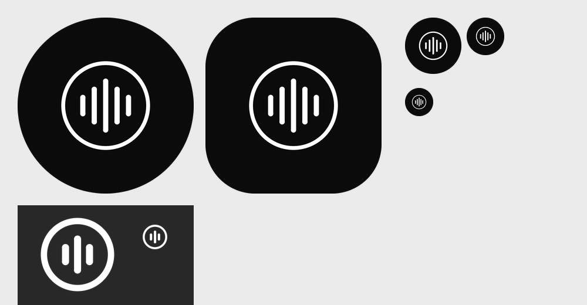

# HiRes

Minimal, local-first Android music player with optional Spotify control. Kotlin, Jetpack Compose, MVVM, Media3.



## Open and run
1. Open this folder in Android Studio (Ladybug or newer, JDK 17). It syncs Gradle and creates the wrapper.
2. Run on a device with music files in shared storage. Grant the audio and notification permissions.

This has not been compiled in the authoring environment (no Android SDK), so expect to fix a few compile errors on first sync.

## Spotify setup
Spotify is optional. Local playback works without it.

1. Create an app in the [Spotify Developer Dashboard](https://developer.spotify.com/dashboard) and enable the Web API.
2. Add this redirect URI exactly: `com.example.hifi://spotify-callback`
3. Put the Client ID in `local.properties` (not committed):
   ```
   SPOTIFY_CLIENT_ID=your_client_id_here
   ```
4. Rebuild, open **Library > Sources > Connect**.

How it works:
- Sign-in uses the Authorization Code flow with PKCE. No client secret is stored in the app.
- Library (saved songs, saved albums, playlists) is read through the official Web API.
- Playback is Spotify Connect control through the Web API. **Spotify plays the audio** in its own app or device; this app sends play, pause, seek, volume and so on. It does not receive, decode or capture Spotify audio.
- Playback control needs a Spotify Premium account and the Spotify app installed. If no device is active, open Spotify and play any track once.

Spotify rules that affect you (see [Spotify's February 2026 migration guide](https://developer.spotify.com/documentation/web-api/tutorials/february-2026-migration-guide)):
- Apps in Development Mode need the app owner to have Premium and are limited in users (5 for new apps). Add testers under User Management in the dashboard.
- Playlist contents can only be read for playlists you own or collaborate on, so other playlists will show an error.

## Layout
- `music/`: `MusicProvider`, `LocalMusicProvider` (MediaStore), Apple Music placeholder
- `spotify/`: `SpotifyAuth` (PKCE), `SpotifyApi`, `SpotifyProvider`, `SpotifyPlayback`
- `metadata/`: on-demand technical metadata for local files. Missing values show as "Bit depth unavailable"
- `playback/`: `PlaybackService` (ExoPlayer + MediaSession, notification and background playback), `PlaybackManager`
- `usb/`: connected USB output and its advertised sample rates
- `ui/`: Now Playing, Library, Sources, shared components

## Known limits
- No bit-perfect claim. Local audio uses Android's normal stack. The USB line shows what the device advertises, not the active stream format.
- Spotify tracks show no codec, bit depth or sample rate because Spotify does not expose them.
- Bit depth for local files is only shown when Android reports it.
- Local playlists are not implemented yet.
- Local album art uses the legacy `content://media/external/audio/albumart` URI and may not load on newer Android versions. Next step: `ContentResolver.loadThumbnail`.
- Spotify tokens are stored in app-private SharedPreferences. Moving them to encrypted storage is a sensible hardening step.
- Apple Music is a placeholder. It must use only official MusicKit capabilities when added.
